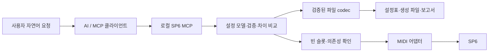

# SP6 MCP — 요구사항 명세서 및 개발 계획

> Kurzweil/Young Chang과 무관한 비공식 개인 프로젝트이며, 공식 승인·제휴가 없다.

문서 버전: **0.2** · 작성·검토 반영일: **2026-11-06** · 대상: **Kurzweil SP6 88건반 / Windows**

이 프로젝트는 **LLM이 신디사이저 설정을 수행할 수 있게 하여, 초보자도 합주·공연용 세팅을 대화로 쉽게 준비하는 것**을 목표로 한다. 이 문서는 그 요구사항과 개발 계획이다.

> **현재 상태(2026-11-06, v0.6.0)**
>
> - **구현됨(오프라인):** `.ksp6`/`.fmlt` 바이트 보존 읽기·쓰기, 근거가 확인된 Multi Zone 필드 codec, 설정표 schema·검증, 새 Multi 파일 생성(`.fmlt`/`.ksp6`)과 차이 비교, MCP stdio 서버와 CLI. 사용법은 [docs/usage.md](docs/usage.md), 필드 근거는 [docs/protocol/multi-fields.md](docs/protocol/multi-fields.md).
> - **쓸 수 있는 Multi 필드:** 이름, Zone 켜짐, MIDI Channel, Program, Key Low/High, Transpose. Volume·Pan은 읽기만 하고, Velocity·컨트롤러·Arp 버튼·페달·FX는 템플릿 값을 그대로 둔다(요청하면 `UNSUPPORTED_FIELD`).
> - **미구현:** 건반 식별·수신·저장(P3·P4). 생성 파일을 편집기가 정상 해석하는지, 건반에 보내 저장되는지는 아직 확인하지 않았다(11장 `파일 생성됨` 단계까지).
> - 건반은 연결 해제 상태이며, 실기 작업은 사용자 재개 지시와 연결 후 진행한다.
> - 개인 백업·생성 파일·검사 보고서는 저장소에 넣지 않는다(`.gitignore`). 테스트는 합성 데이터만 쓴다.
> - 라이선스: MIT([LICENSE](LICENSE)). 이 저장소의 코드·문서에만 적용되며, 제조사·사용자 음색 데이터에는 적용되지 않는다(IP-02).

## 1. 목적

**인공지능 시대에 맞춰 신디사이저 설정도 LLM이 수행할 수 있게 한다. 초보자도 LLM과의 대화를 통해 합주와 공연에 필요한 세팅을 쉽게 준비할 수 있도록 한다.**

사용자는 원하는 음색과 연주 방식을 자연어로 설명하고, LLM은 이를 음색 선택·건반 분할·옥타브·볼륨·컨트롤러 설정으로 구체화한다. 설정 내용과 변경 이유를 쉬운 말로 안내해 사용자가 곡별 세팅을 이해하고 조정할 수 있어야 한다.

첫 지원 대상은 Kurzweil SP6다. MCP는 LLM의 요청을 검증하고 실제 설정 파일 생성과 기기 전송·저장으로 연결하는 실행 계층을 제공한다. 완성된 세팅은 합주나 공연에서 건반 본체로 사용할 수 있어야 한다.

이를 위해 파라미터마다 `화면 확인 → 클릭/스크롤/드래그 → 재확인`을 반복하던 방식을 **구조화된 설정 입력 → 검증 → 파일 생성 → 필요한 데이터 한 건 전송·저장**으로 바꾼다.

핵심 요구사항은 다음 세 가지다.

1. **속도:** 정상 작업 경로에서 파라미터마다 화면을 읽거나 마우스로 조작하지 않는다. 오프라인 MVP(P2)의 자동화 목표는 파일 생성까지이며, P4 이전의 실기 전송·저장은 사용자의 편집기 조작을 거친다.
2. **보존:** 기존 밴드 설정, Factory/User 음색과 Multi를 덮어쓰거나 초기화하지 않는다. 새 저장은 항상 확인된 빈 슬롯에 한다.
3. **정확성:** 파일 생성, 전송, 건반 영구 저장, 실제 청음 완료를 서로 다른 상태로 보고한다.

## 2. 사용자 경험과 용어

초보자는 원하는 연주 방식으로, 익숙한 사용자는 구체적인 설정값으로 다음처럼 요청할 수 있어야 한다.

- “합주할 곡에 맞춰 왼손은 피아노, 오른손은 스트링으로 나눠줘.”
- “왼손은 Pad 87, 오른손은 Lead 1200, C6에서 나누고 오른손만 두 옥타브 내려줘.”
- “오른손 볼륨을 105로 하고, ModWheel과 FILTER1은 오른쪽에만 적용해줘.”
- “건반 연결 없이 먼저 파일을 만들고 변경 내용을 보여줘.”
- “연결했으니 빈 Multi 슬롯에 저장해줘.”

서버는 초보자에게 음색 이름, 담당 건반 범위, 실제 음높이, 볼륨, 켜짐 상태를 중심으로 설명한다. 원시 바이트·SysEx·내부 오프셋은 진단 자료에서 제공한다. 모호한 음이름이나 겹침 의도만 필요한 경우 확인하고, 이미 명확한 값은 반복해서 질문하지 않는다.

음색 이름과 공장/사용자 템플릿은 사용자가 제공한 로컬 백업이나 장치 수신 자료에서 가져온다. 조회할 자료가 없으면 번호만 표시한다. 이름을 추정하거나 공장 Program 이름표를 저장소에 동봉하는 대신, 조회 출처와 해시를 추적한다.

| 용어 | 의미 |
|---|---|
| Program | 피아노·스트링·리드 등 개별 음색. Multi와 별도의 번호 공간을 사용한다. |
| Multi | 최대 4개 Zone의 Program·범위·컨트롤러 등을 조합한 연주 설정. |
| Zone | 한 Program을 배치하는 구역. 분할 또는 의도적인 겹침이 가능하다. |
| Zone Arp 버튼 (`arp_button`) | `yes`는 해당 Zone에서 ARP ON/OFF 버튼 제어를 허용하고, `no`는 해당 Zone의 Arp를 끈다. Multi를 불러온 직후 실제 Arp On 상태와는 별개다. 패턴 등 Arp 설정은 Program에 속한다. |
| 설정표 | 파일 형식과 무관한 JSON 목표값. 생성 파일과 별도 보관한다. |
| Artifact | 생성 파일, 설정표, 검증·변경 보고서와 해시를 묶은 산출물. |
| Edit buffer | 현재 편집 중인 임시 데이터. 영구 저장 완료로 취급하지 않는다. |
| MCP | AI 클라이언트가 검증된 도구를 호출하는 인터페이스. SP6 통신 형식을 대신 정의해 주는 기술은 아니다. |

## 3. 현재 확보한 근거와 한계

| 항목 | 확인 상태(2026-11-06) |
|---|---|
| `.ksp6` 컨테이너 | 기존 파일에서 Program/Multi 레코드의 번호, 이름, 원본 payload와 빈 payload를 읽을 수 있다. |
| 무변경 파일 재생성 | 8,203,199-byte 백업을 읽고 레코드를 다시 생성했을 때 원본과 바이트 및 SHA-256이 일치했다. |
| Multi 내부 필드 | `multi-codec/0.1`: Zone 켜짐·Channel·Program·Key 범위·Transpose를 읽고 쓴다. Multi 1050의 실기 수신 기록, 편집 전후 스냅샷과 일치하며, 같은 편집을 codec으로 재현하면 편집기 결과와 해당 바이트가 모두 같다. Volume·Pan은 읽기 전용. Velocity·컨트롤러·Arp는 미해석. |
| 새 Stand Up 파일 | 2026-11-06 백업을 템플릿으로 로컬 생성·재해석 확인(87/1200, 21–83/84–108, −24 ST). 편집기 열기·실기 저장은 미확인. Volume 90/105, 컨트롤러, Arp 버튼은 템플릿 값 그대로다. |
| MIDI 연결 | 과거 연결에서 Identity 응답과 편집기를 통한 개별 Program/Multi 수신을 확인했다. 자체 도구의 SP6 객체 수신·쓰기 프로토콜은 미구현이다. |
| GUI 대체 | SoundTower가 개발한 SP6 Sound Editor는 MIDI로 개별 Program/Multi/Effect와 전체 Bank를 송수신한다. 직접 데이터 처리 경로의 존재는 확인했지만, 본 프로젝트가 사용할 쓰기 명세는 확보·검증이 필요하다. |
| 기종 호환 | 다른 Kurzweil 기종의 파일/프로토콜은 참고 자료다. PC3 등의 구현을 SP6와 동일하다고 가정하지 않는다. |

기준 백업에는 User Program 172개와 User Multi 30개가 들어 있었으며 무변경 재생성 결과는 원본과 정확히 일치했다. 일부 앞선 백업에는 User Multi payload가 없었다. 따라서 파일의 빈 payload만으로 실제 장치의 빈 슬롯이나 백업 완전성을 판단하지 않는 것이 필수 요구사항이다.

## 4. 개발 범위

### 4.1 오프라인 MVP

첫 제품 범위는 **MCP를 통한 파일 분석·목표값 검증·새 Multi 파일 생성**이다.

- 연결 없이 `.ksp6` 파일을 분석하고 객체·슬롯 목록을 제공한다.
- 검증된 템플릿의 사본으로 최대 4개 Zone의 Multi를 만든다.
- Program 선택, MIDI Channel, Key/Velocity 범위, Transpose, Volume/Pan, Zone On/Off를 우선 지원한다.
- 이어서 Zone Arp 버튼 제어 허용 여부, Volume 컨트롤러 Entry와 ModWheel/Filter1의 Zone별 활성화 및 초기값을 지원한다.
- 원본과 관련 없는 객체, 미해석 데이터, 페달·Pitch Wheel·FX 등 요청하지 않은 설정은 보존한다.
- 생성 파일과 사람이 읽을 수 있는 변경 보고서를 제공한다.
- 검증되지 않은 내부 필드는 명확한 미지원 오류를 반환한다.

MVP 사용자 흐름은 다음과 같다.

1. 사용자 로컬 백업에서 이름·해시가 확인된 템플릿을 선택하고 MCP로 설정 검증·파일 생성을 수행한다.
2. P2부터 P4 직접 저장이 검증되기 전까지는 생성 파일을 사용자가 SP6 Sound Editor로 연다. 편집기가 파일을 해석하는지 확인한 뒤 **해당 Multi 한 건만** 전송한다. 전송 전에 한 건 전송 방식과 실제 전송 대상(Edit buffer 또는 파일의 Multi ID 슬롯)이 검증되어 있어야 하며, 대상이 불명확하면 전송하지 않고 보류한다(13장 2항). 검증된 방식이 파일의 Multi ID 슬롯에 바로 쓰는 경우에는 전송 직전에 그 실제 슬롯이 본체에서 비어 있음을 확인한다. Edit buffer로 가는 경우에는 3단계의 본체 SAVE 절차로 저장한다.
3. 본체의 빈 User Multi 슬롯과 저장 ID를 확인하여 저장하고 결과를 기록한다. 본체 Save Dialog가 기존 Multi 교체 경고를 표시하면 저장하지 않고 다른 빈 ID를 고른다. 근거: 매뉴얼 Multi Save Dialog 4-11(PDF 57쪽). 파일 생성 완료와 실기 저장 완료를 구분한다.
4. **Bank 일괄 전송(`Send All`)과 본체 File Page의 `All-Ovrwrte` 불러오기는 금지한다.** 오프라인 Bank의 빈 항목까지 전송하면 장치의 기존 User 슬롯이 지워질 수 있고, `All-Ovrwrte`는 장치의 모든 User 객체를 삭제한 뒤 불러온다. 근거: 매뉴얼 Load Method 6-9(PDF 79쪽). 위 2–3단계의 편집기 경로는 한 건 전송 방식이 검증된 파일 형식에 한해 제공한다.

### 4.2 후속 단계

- **장치 읽기:** MIDI 포트·SP6 식별, 개별 객체 수신, 실제 슬롯 상태 및 참조 Program 확인.
- **제한된 쓰기:** 지원이 검증된 환경에서 확인된 빈 User Multi 슬롯에 한 건만 저장하고 수신 비교.
- **Program 편집:** 새 빈 User Program 슬롯으로 복제 후, 검증된 VAST/Arp 필드를 편집하는 기능. 초기에는 이미 저장된 Program 1200을 재사용한다.
- **초보자용 화면:** MCP/공통 코어를 사용하는 간단한 설정 화면. 첫 MVP의 필수 요소는 아니다.

### 4.3 제외 범위

공장 초기화, 펌웨어 업데이트, 기존 사용 중인 슬롯 덮어쓰기·삭제, 전체 Bank 복원, Global Transpose 및 전역 페달 설정 변경은 제공하지 않는다. 임의의 원시 SysEx 전송 도구도 노출하지 않는다.

신시사이저 소프트웨어 음원 구현, 자동 원곡 음색 복제, 악보/PDF 자동 해석, 공연 중 컴퓨터를 필수로 사용하는 구성, 타 기종 지원도 초기 범위에서 제외한다. 기술적 저장 확인과 실제 소리의 적합성 판단은 구분한다.

## 5. 기능 요구사항

| ID | 요구사항 | 완료 기준 |
|---|---|---|
| FR-01 | 파일 검사와 목록 | 형식·크기·SHA-256, 객체 종류/번호/이름, 해석 지원 범위, 수집 범위의 알려짐 여부를 반환한다. 종류/번호로 필터링하고 페이지 단위로 조회한다. |
| FR-02 | 내용 보존 읽기/쓰기 | 지원 fixture를 수정 없이 재생성하면 원본과 바이트가 일치한다. 알 수 없는 영역도 보존하며 손상·중복·잘못된 레코드를 감지한다. |
| FR-03 | Multi 필드 해석 | 지원하는 내부 형식에 대해 검증된 필드만 해석한다. 각 매핑에 근거 fixture, 값 범위, 형식/버전 조건을 기록한다. 추정 오프셋으로 쓰지 않는다. |
| FR-04 | 설정표 검증 | Zone·음역·음색 참조·음량·Transpose·컨트롤러의 타입과 범위를 검사하고, 오류 필드를 정확히 반환한다. |
| FR-05 | 새 Multi 생성 | 템플릿 원본 파일(`template.source_path`)은 수정하지 않고 사본을 생성한다. 검증된 템플릿과 목표값으로 대상 Multi만 변경하며, 다른 객체의 바이트는 동일하게 보존한다. 대상 ID가 원본에서 이미 점유되어 있으면 덮어쓰지 않고 `SLOT_OCCUPIED`로 거부한다. 원본의 빈 레코드는 장치 슬롯이 비었다는 근거가 아니다(FR-09). |
| FR-06 | 결과와 변경 비교 | 입력 설정표, 해석된 결과, 대상 ID, 변경 필드, Program 의존성, 미확정 항목, 파일 해시를 반환한다. 생성 결과를 다시 해석해 목표값과 비교한다. |
| FR-07 | 선택적 객체 내보내기 | 한 Multi만 안전하게 불러오는 형식이 검증되면 우선 제공한다. 전체 컨테이너만 가능한 경우 그 사실을 표시하고, 자동 전체 전송을 수행하지 않는다. |
| FR-08 | 장치 식별·개별 수신 | 명시한 포트·장치만 사용하고 Identity/객체 응답을 검증한다. 전체 Bank 수신은 정상 경로에 요구하지 않는다. |
| FR-09 | 빈 슬롯 보호 | 파일의 빈 payload와 실제 장치의 빈 슬롯을 구분한다. 실기 쓰기 직전에 대상 슬롯을 수신하여 빈 상태를 확인한다. 미확인 상태는 저장 불가다. |
| FR-10 | 한 건 영구 저장 | 검증된 객체와 대상 ID만 전송한다. 영구 메모리에서 다시 받은 객체가 전송한 객체와 일치할 때만 저장 완료로 보고한다. 장치의 저장 응답(ACK)은 존재가 확인된 경우에만 추가 근거로 쓰며(13장 3항), 응답만으로 저장 완료로 보고하지 않는다. |
| FR-11 | 중단·재개 | 요청 ID, 산출물 해시, 대상 장치/슬롯, 마지막 확정 상태를 기록한다. 중단되면 새 전송을 멈추고, 재개 전 실제 상태를 다시 확인한다. |
| FR-12 | 상태·지원 기능 공개 | 오프라인/읽기/쓰기 지원 여부와 미구현 기능을 명확히 반환한다. 연결되지 않았을 때 성공을 가장하거나 GUI 조작으로 몰래 대체하지 않는다. |

### 5.1 데이터 모델의 필수 규칙

- **번호 공간:** `program_id`와 `multi_id`를 별도 필드로 다룬다. User 저장 대상은 SP6의 1025–2048 범위에서 선택하며, 현재 fixture의 전체 레코드 수 2304를 저장 가능 범위로 오해하지 않는다.
- **음이름:** 내부 기준은 MIDI note 0–127, 표시는 `C4 = MIDI 60`이다. SP6 88건반의 물리 범위는 21–108이다. 범위와 Transpose를 독립적으로 다루고 실제 생성 음높이도 표시한다.
- **Zone:** 1–4번을 명시한다. 활성 Zone의 해석된 결과에는 Program, MIDI Channel, Key/Velocity 범위, Transpose, Volume/Pan이 필요하다. 입력 필드를 생략하면 아래 템플릿 보존 규칙을 적용한다. 비활성 Zone은 확실히 비활성화한다.
- **분할과 겹침:** 분할 모드에서는 원치 않는 겹침을 오류로 처리한다. Layer용 의도적 겹침은 설정표에서 허용할 수 있어야 한다. 겹침을 일률적으로 금지하거나 자동으로 범위를 바꾸지 않는다. `range_policy: "split"`이 분할 모드이며, 의도적 겹침을 나타내는 값(예: `layer`)과 Zone 단위 허용 방식은 P1 schema에서 확정한다.
- **검증 범위:** Key 값은 MIDI 0–127, Velocity 값은 1–127, Volume/Pan은 0–127 또는 `None`(JSON `"none"`), Channel은 1–16을 검사한다. Pan 64는 중앙이다. 같은 MIDI Channel의 Zone들은 같은 Program을 사용하므로, 서로 다른 `program_id`를 지정하면 오류로 보고한다(매뉴얼 Channel Page 5-10, PDF 68쪽). Transpose는 확인된 장치/codec 범위를 적용하고, 물리 건반 범위를 벗어난 음은 오류 또는 명시적 경고로 보고한다.
- **역전 범위:** 읽기에서는 Key Low > High와 Velocity Low > High를 정상 데이터로 보존한다. 새 `split` 생성에서는 기본적으로 거부하되, Zone별 `allow_inverted_key_range: true` 또는 `allow_inverted_velocity_range: true`로 제외 구간(역전 범위)을 명시하면 해당 범위를 허용한다. Low/High를 자동 교환하지 않으며, 허용 후에도 장치 지원과 실제 발음 구간의 겹침 정책을 검사한다. 근거: [SP6 Musician’s Guide Rev. F](https://kurzweil.com/wp-content/uploads/2026/05/SP6-Musicians-Guide_Rev-F.pdf), Key/Velocity Page 5-3–5-4(PDF 61–62쪽).
- **이름:** Multi 이름의 장치 제한 16자를 검증한다. 인코딩 불가 문자는 오류로 보고한다. 근거: 같은 매뉴얼 Multi Save Dialog 4-11(PDF 57쪽).
- **초기값:** Common Volume(`volume`, 매뉴얼 Mixer Page의 Zone Volume)과 Volume 컨트롤러 Entry Position(`volume_entry`)의 의미·충돌을 함께 검사한다. Volume/Pan의 명시적 `"none"`은 이전 Multi/Program 모드에서 해당 MIDI 채널이 사용하던 Volume/Pan 값을 유지한다. 필드 생략은 템플릿 값 보존이며, `0`, 끔(`enabled: false`), `"none"`, 필드 생략은 서로 다른 상태다. JSON `null`을 `"none"` 대신 사용하지 않는다. ModWheel과 Filter1 초기값도 별개다. 근거: 같은 매뉴얼 Mixer Page 5-2–5-3(PDF 60–61쪽). 매뉴얼 Controllers Page 5-8–5-10(PDF 66–68쪽)은 컨트롤러별 Value·State·Scale·Add를 설명하지만 Entry라는 이름과 그 `None` 값은 명시하지 않으므로, `volume_entry`·컨트롤러 `entry`의 장치 필드 대응과 `"none"` 허용 여부는 P2 codec 근거로 확정한다.
- **Arp:** `arp_button`은 `"yes"`/`"no"`로 표현한다. 패턴·Beats·Latch 등 Program Arp 설정, Zone의 버튼 제어 허용, 현재 ARP ON/OFF 상태를 각각 구분한다. 근거: 같은 매뉴얼 Buttons Page 5-5(PDF 63쪽).
- **Program 의존성:** User Program은 ID뿐 아니라 수신 데이터/백업의 이름·해시와 출처를 추적한다. 참조 Program이 없거나 달라졌으면 보고하며, 기존 Program을 자동으로 교체하지 않는다.
- **템플릿 출처:** `template.source_path`는 사용자 로컬 백업 또는 장치 수신 Artifact의 경로이고, 상대 경로는 서버에 설정된 작업 루트 기준으로 해석한다. `template.sha256`은 그 원본 파일 전체의 해시다. 객체 종류·ID와 함께 기록하고 codec 버전도 결과에 남긴다. 해시가 다르면 `SOURCE_CHANGED`로 중단한다.
- **미지정 필드:** 검증된 템플릿의 기존 값을 보존한다. 기본값을 임의 생성하거나 요청하지 않은 페달·FX·Pitch Wheel 설정을 바꾸지 않는다. 보존을 보장할 수 없는 형식은 생성하지 않는다.

## 6. 필수 보존 및 저장 규칙

이 규칙은 모든 쓰기 경로에 적용하며 클라이언트의 안내 문구만으로 구현하지 않는다.

1. **원본 파일 불변:** 입력 백업과 설치 파일을 수정하지 않는다. 출력 경로가 입력과 같거나 이미 존재하는 파일이면 덮어쓰거나 이름을 자동으로 바꾸지 않고 `OUTPUT_PATH_DENIED`로 거부한다. 호출자는 새 경로로 다시 요청한다. 출력 도중 실패하면 완성 파일로 표시하지 않는다.
2. **사용 중인 슬롯 보호:** 초기 제품에는 `force overwrite` 예외를 두지 않는다. 1050 등 특정 번호만 보호하는 것이 아니라 모든 점유 슬롯을 보호한다.
3. **불명확한 빈 상태 보호:** 백업에서 레코드가 없거나 payload가 비어 있어도 실제 건반이 비었다고 단정하지 않는다. 응답 오류·시간 초과·미수신은 `unknown`이다.
4. **직전 재확인:** 쓰기 준비 시점과 실행 직전의 장치, SysEx ID, 객체 종류, 대상 ID, 파일 해시를 일치시킨다. 대상이 사용 중으로 바뀌면 중단한다. SysEx ID를 연결 편의를 위해 자동 변경하지 않는다.
5. **동시 접근 제어:** 장치별 쓰기를 직렬화하고 요청을 잠근다. 다른 편집기/서버의 동시 변경을 완전히 막는 하드웨어 기능은 확인되지 않았으므로 동시 쓰기 환경에서는 실행하지 않는다.
6. **재시도 규칙:** 영구 저장 결과가 불명확하면 자동으로 다시 쓰지 않는다. 먼저 해당 슬롯을 다시 읽고 `저장됨 / 저장되지 않음 / 확인 불가`를 구분한다. 장치 쓰기를 일반 파일처럼 원자적 롤백할 수 있다고 가정하지 않는다.
7. **중단 상태 존중:** 연결 해제, 사용자 중지 또는 취소 후 추가 전송을 멈춘다. 이미 전송한 명령이 취소로 되돌아갔다고 보고하지 않는다.
8. **기록:** 변경 계획, 원본/결과 해시, 수신 범위, 실제 대상 ID, 단계별 결과를 로컬에 남긴다. 기존 객체의 사전/사후 비교가 불가능하면 비교 완료라고 보고하지 않는다.
9. **출력 경로 제한:** `sp6_multi_build`와 `sp6_device_receive`는 설정된 출력 폴더(기본 `artifacts/`) 내부에만 새 파일을 쓴다. 호출자가 주는 `output_path`는 그 폴더 기준 상대 경로로 제한하고, `..`·절대 경로·심볼릭 링크/Windows junction을 해석한 실제 경로가 폴더 밖이면 `OUTPUT_PATH_DENIED`로 거부한다. 입력 파일의 상대 경로 기준인 작업 루트(5.1 템플릿 출처)와 구분한다. 원본 및 기존 파일 보호는 같은 폴더 안에서도 적용한다.

저장 권한의 단위는 **사용자 저장 지시 1건 = `plan_id` 1개 = 대상 슬롯 1개**다. 계획에는 장치·객체 종류·슬롯·Artifact 해시를 결합한다. 동일 계획의 준비·실행 과정에서 서버가 사용자 확인을 반복 요구하지 않으며, 클라이언트 자체의 도구 실행 확인은 클라이언트 설정을 따른다. 대상이나 Artifact가 달라지면 기존 승인을 승계하지 않고 새 지시와 계획으로 연결한다. 연결·지원 상태도 실행 직전에 확인한다. 쓰기 준비/실행 분리는 데이터 무결성을 위한 내부 절차다.

## 7. MCP 인터페이스 초안

도구명과 인자는 설계 초안이다. 모든 입력·출력은 JSON Schema로 정의하고, 상세 바이트 대신 파일 경로/Artifact ID와 해시를 반환한다. MCP 도구 스키마는 [공식 Tools 명세](https://modelcontextprotocol.io/specification/latest/server/tools)를 따른다.

| 도구 | 주요 입력 | 주요 출력 | 도입 단계 / 부작용 |
|---|---|---|---|
| `sp6_capabilities` | 없음 | 구현된 파일 형식·필드, 장치 읽기/쓰기 지원과 제한 | P1 / 읽기 |
| `sp6_file_inspect` | `path`, 객체 필터, 페이지 | 파일 해시, 인벤토리, 수집 범위·빈 상태의 근거 | P1 / 파일 읽기 |
| `sp6_multi_read` | 파일/객체 참조, `multi_id` | 해석된 Multi, 미해석 필드, codec 근거 | P2 / 파일 읽기 |
| `sp6_multi_validate` | `spec`, 템플릿·참조 정보 | 오류/경고와 필드 경로, 생성 가능 여부 | P1–P2 / 검증 |
| `sp6_multi_build` | `spec`(템플릿 원본 경로·해시 포함), `artifacts/` 기준 상대 `output_path` | Artifact ID, 생성 경로/해시, 변경 보고서 | P2 / 새 로컬 파일 |
| `sp6_artifact_diff` | 템플릿 원본 파일, Artifact | 필드별 차이, 다른 객체 보존 여부 | P2 / 파일 읽기 |
| `sp6_device_discover` | 선택적 포트 필터 | 포트·Identity·호환 정보 | P3 / 식별 요청 |
| `sp6_device_receive` | 장치, 객체 종류/ID 또는 명시적 범위 | 수신 Artifact, 응답·수집 범위 | P3 / 요청·수신 |
| `sp6_write_prepare` | 장치, Artifact, 대상 ID, 선택적 후보 검색 범위·상한 | 저장 가능 여부, 검증된 계획 ID, 의존성·대상 상태, 확인된 빈 슬롯 후보 목록 | P4 / 읽기 확인만 |
| `sp6_write_commit` | `plan_id`, `request_id` | 저장 작업 ID(`operation_id`)와 단계별 결과 | P4 / 한 건 영구 저장 |
| `sp6_write_result` | 저장 작업 ID(`operation_id`) | 마지막 확정 상태·수신 비교 결과 | P4 / 상태 조회 |

### 7.1 도구 동작 규칙

- 도구 목록과 capability 보고를 실제 구현에 맞춘다. 미구현 요청에는 명확한 미지원 오류를 반환한다.
- JSON에 알 수 없는 필드, 범위 밖 값, 모호한 객체 종류가 있으면 명확한 오류를 반환한다. MCP 도구 annotation은 실제 부작용에 맞게 지정하되 보호 수단을 대신하지 않는다.
- 읽기 도구는 장치 영구 메모리·Global 설정을 변경하지 않는다. `device_receive`는 명시한 읽기 요청만 허용한다.
- `write_prepare`는 6장의 지시 단위에 Artifact 해시·codec 버전·의존 Program·대상 장치/ID를 묶는다. 계획 만료/데이터 변경/재연결 시 재확인한다. `commit`은 준비된 계획만 받는다.
- 대상이 점유되었거나 미확인이면 실행 가능한 `plan_id`를 발급하지 않는다. 요청된 범위·상한 안에서 읽어 확인한 빈 슬롯만 후보로 반환하며, 미검색 범위는 `unknown`으로 표시한다. 후보의 출처·확인 시점을 포함하고, 후보 선택 후에는 해당 슬롯으로 새 계획을 준비한다.
- `plan_id`는 한 번만 실행한다. 같은 `request_id`의 재호출과 이미 실행된 `plan_id`의 재호출은 새 전송 없이 기존 `operation_id`의 결과를 반환한다. 결과 불명확 상태의 저장을 중복 전송하지 않으며, 저장되지 않음을 확인한 뒤의 재시도도 사용자의 새 저장 지시와 새 계획으로 진행한다.
- 정상 작업의 파라미터 반복은 서버 내부에서 처리한다. 모델이 필드 하나마다 도구를 호출하지 않게 한다.
- 결과에는 `status`, `operation_id`, `phase`, `warnings`, `evidence`를 포함한다. `phase`는 11장 상태 중 근거를 확보한 마지막 단계다. 실패 시 `error.code`, `error.message`, `error.field`, `retryable`, `device_write_state`를 제공한다.
- `device_write_state`는 `not_sent`(전송 전), `saved`(영구 저장·수신 일치), `not_saved`(다시 읽어 저장되지 않음을 확인), `unknown`(확인 불가) 중 하나이며 6장 6항의 판정을 따른다. `READBACK_MISMATCH`는 `saved`로 보고하지 않는다. `retryable: true`는 장치 상태를 바꾸지 않는 재호출이 안전하다는 뜻이며, 저장 재전송 허가를 의미하지 않는다.
- 대표 오류: `UNSUPPORTED_FORMAT`, `UNSUPPORTED_FIELD`, `INVALID_SPEC`, `SOURCE_CHANGED`, `DEPENDENCY_MISMATCH`, `DEVICE_DISCONNECTED`, `PORT_BUSY`, `SLOT_OCCUPIED`, `SLOT_STATE_UNKNOWN`, `PLAN_STALE`, `WRITE_STATE_UNKNOWN`, `READBACK_MISMATCH`, `OUTPUT_PATH_DENIED`.

## 8. 입력 설정표 예시: Stand Up!

다음은 **설계 중인 입력 형식 예시**다. 음이름은 설명용이고 실제 값은 MIDI 번호다. `source_path`는 사용자가 제공할 로컬 파일의 예시 경로이고 SHA-256은 형식 설명용 값이므로, 실제 입력 시 원본 경로와 해시로 바꾼다.

```json
{
  "schema_version": "1",
  "operation": "create_multi",
  "name": "STANDUP_LIVE",
  "preferred_user_multi_id": 1055,
  "template": {
    "source_path": "private/backups/sp6-template.ksp6",
    "sha256": "0123456789abcdef0123456789abcdef0123456789abcdef0123456789abcdef",
    "kind": "multi",
    "id": 1
  },
  "range_policy": "split",
  "zones": [
    {
      "zone": 1,
      "enabled": true,
      "program_id": 87,
      "midi_channel": 1,
      "key_low": 21,
      "key_high": 83,
      "allow_inverted_key_range": false,
      "allow_inverted_velocity_range": false,
      "transpose_semitones": 0,
      "velocity_low": 1,
      "velocity_high": 127,
      "volume": 90,
      "volume_entry": 90,
      "pan": 64,
      "arp_button": "no",
      "controllers": {
        "modwheel": { "enabled": false },
        "filter1": { "enabled": false }
      }
    },
    {
      "zone": 2,
      "enabled": true,
      "program_id": 1200,
      "midi_channel": 2,
      "key_low": 84,
      "key_high": 108,
      "allow_inverted_key_range": false,
      "allow_inverted_velocity_range": false,
      "transpose_semitones": -24,
      "velocity_low": 1,
      "velocity_high": 127,
      "volume": 105,
      "volume_entry": 105,
      "pan": 64,
      "arp_button": "yes",
      "controllers": {
        "modwheel": { "enabled": true, "scale_percent": 100, "entry": 0 },
        "filter1": { "enabled": true, "scale_percent": 100 }
      }
    },
    { "zone": 3, "enabled": false },
    { "zone": 4, "enabled": false }
  ]
}
```

`None`과 필드 생략을 구분하는 **부분 설정 예시**는 다음과 같다. 이 조각은 `zones` 배열의 한 항목이며, 실제 요청에서는 위 예시의 최상위 구조 안에 넣는다. 필수·선택 필드의 최종 목록은 P1의 JSON Schema에서 확정한다.

```json
{
  "zone": 1,
  "volume": "none",
  "volume_entry": "none",
  "pan": "none"
}
```

이 부분 설정은 Volume/Pan의 이전 채널 값을 유지한다. `volume_entry: "none"`으로 Volume 컨트롤러의 수치 초기값 주입을 해제하는 것은 설계 의도이며, codec profile이 Entry 대응과 `"none"` 처리를 검증한 경우에만 지원한다(5.1 초기값). 검증되지 않았거나 지원하지 않는 `volume_entry`·컨트롤러 `entry` 동작은 추정해 쓰지 않고 `UNSUPPORTED_FIELD`로 거부한다. 각 필드를 생략하면 해당 템플릿 값을 보존하므로 결과가 다를 수 있다. `split` 정책에서 제외 구간을 만들 때는 해당 Zone의 `allow_inverted_key_range` 또는 `allow_inverted_velocity_range`를 명시적으로 `true`로 바꾼다.

Stand Up 예제의 전제는 다음과 같다.

- 왼손 Pad는 A0–B5(21–83), 오른손 Lead는 C6–C8(84–108)이다. B5/C6 경계에 겹침이나 빈틈이 없다.
- Lead의 -24 ST는 물리 건반 범위를 바꾸지 않으며, 생성 MIDI 음높이는 C4–C6다(84−24=60, 108−24=84). Program의 실제 발음과 연주를 통한 최종 확인은 별도다.
- Program 1200 `STANDUP_LD12`는 이미 저장된 의존 음색으로 재사용한다. Arp Upwards / 1/16 / Shift 0 / Duration 60% / Latch Keys는 해당 Program 기록을 참조한다.
- Zone 1의 `arp_button: "no"`는 Arp를 끄고, Zone 2의 `"yes"`는 버튼 제어를 허용한다. Multi를 불러온 직후의 실제 ARP ON/OFF 상태는 별도로 확인한다.
- FILTER1 초기값과 최종 BPM은 미확정이므로 생성기가 추측하지 않는다. 생략 필드는 템플릿 값을 보존하고, 실제 적용값과 미조정 상태를 보고한다.
- 1055는 생성 파일에서 새 Multi에 쓰는 ID이자 저장 후보 번호이며, 장치 슬롯이 비었다는 근거가 아니다. 저장 준비 시 빈 상태를 다시 확인하고, 사용 중이면 `sp6_write_prepare`가 요청된 범위에서 확인한 다른 빈 후보를 보고한다. 실제 저장은 선택한 한 슬롯에 결합된 새 계획으로 진행한다.

## 9. 구성안



- **공통 코어:** MCP, CLI, 향후 간단한 화면에서 같은 검증·생성 로직을 사용한다. MCP 계층에 바이너리 편집 로직을 섞지 않는다.
- **파일 codec:** 컨테이너 보존 처리와 Multi 내부 필드를 분리하고, 지원 조건을 가진 codec profile을 사용한다. 파일 저장 형식과 MIDI 전송 형식도 구분한다.
- **MIDI 어댑터:** 식별·읽기·쓰기를 분리한다. 장치/OS 버전별 지원 근거를 관리하고, 검증되지 않은 환경에서 쓰기를 활성화하지 않는다.
- **로컬 실행:** Windows를 우선 지원하며, 정상 작업에 인터넷 연결이나 유료 서비스를 요구하지 않는다. HTTP 서버 공개는 초기 범위에서 제외한다.
- **구현 후보:** Python과 공식 MCP Python SDK를 사용한다. 실제 클라이언트 호환성을 확인한 뒤 SDK·의존성·프로토콜 대상 버전을 고정한다. 검증하지 않은 특정 SDK 버전이나 API 이름은 현재 확정하지 않는다.
- **stdio:** 초기 연결 방식은 stdio다. 표준 출력은 MCP 메시지 전용이며, 진단 로그는 표준 오류/로컬 파일로 보낸다. [MCP stdio 전송 공식 명세](https://modelcontextprotocol.io/specification/latest/basic/transports/stdio)를 따른다.
- **조작 경로:** GUI 좌표나 스크린샷에 의존하지 않는다. SP6 Sound Editor로 생성 파일을 열어 보는 검증은 보조 수단이며, 정상 경로를 GUI 자동 조작으로 구현하지 않는다.

현재 코드 배치다(v0.6.0). `midi/`와 장치 시뮬레이터는 P3에서 추가한다.

```text
sp6-mcp/
  README.md, LICENSE, pyproject.toml
  src/sp6_mcp/
    container.py       # .ksp6/.fmlt 레코드 보존 읽기·쓰기
    multi_codec.py     # 근거가 확인된 Multi Zone 필드
    spec.py            # 설정표 JSON 모델
    validate.py        # 교차 검증·의존성·빈 슬롯 경고
    build.py           # 새 Multi 파일 생성·검증·차이 비교
    workspace.py       # 입력 루트 / artifacts 출력 경로 정책
    server.py          # MCP stdio 도구
    cli.py             # 같은 코어의 명령줄
  tests/               # 합성 데이터만 사용 (synth.py)
  scripts/             # 로컬 비공개 백업 검증 도구
  docs/usage.md        # 설치·등록·사용 흐름
  docs/protocol/       # 필드 근거
  examples/            # 설정표 예시
  artifacts/           # 생성물 (git 제외)
```

구현 시 이 README를 계획의 진입점으로 유지한다. 개인 백업이나 연주 자료를 사용자의 공개 허용 없이 공개 fixture에 포함하지 않는다.

## 10. 비기능 요구사항

| ID | 요구사항 |
|---|---|
| NFR-01 | 오프라인 기능은 장치 없이 시작·사용할 수 있다. 파서나 모델을 import할 때 MIDI 포트를 열지 않는다. |
| NFR-02 | 8.2 MB 기준 파일의 읽기와 무변경 재생성은 각각 준비된 프로세스에서 P95 **2초 이내를 목표**로 한다. 측정 환경, Python/codec 버전과 측정 횟수를 기록한다. 2026-11-06 측정(Windows 11, Python 3.14.2, v0.5, 30회): 읽기(자체 round-trip 검사 포함) P95 0.048초, 재생성 P95 0.011초. |
| NFR-03 | codec 지원 후 정형 Multi 생성에는 이미지 인식 0회, 파라미터별 모델 왕복 0회를 요구한다. 실기 저장까지 정상 작업 흐름은 약 5회 이내의 MCP 호출을 목표로 한다. |
| NFR-04 | MIDI 전송 시간·본체 메모리 저장 시간과 서버 처리 시간을 구분해 기록한다. 장치 응답 대기는 시간 제한을 가지며, 무기한 대기·고정된 긴 sleep·무제한 재시도를 하지 않는다. |
| NFR-05 | 같은 입력/템플릿/codec 버전은 같은 생성 바이트를 만든다. 날짜 등 가변 메타데이터는 외부 manifest에 분리한다. |
| NFR-06 | 한글 Windows 경로와 UTF-8 설정표를 지원한다. 공백이 있는 경로에서도 동작하고, 셸 명령 문자열 연결에 의존하지 않는다. |
| NFR-07 | 파일 크기·레코드 경계·개수·정숫값을 검사한다. 잘못된 입력이 원본 변경, 무제한 메모리 사용, MIDI 전송을 일으키지 않아야 한다. |
| NFR-08 | 구현/codec 버전, 설정표, 출력 파일, 변경 보고서, 저장 결과를 추적할 수 있다. 거대한 바이너리나 전체 백업을 MCP 응답에 직접 포함하지 않는다. |

## 11. 개발 단계와 종료 조건

| 단계 | 작업 | 종료 조건 |
|---|---|---|
| **P0 — 현황 정리** | 요구사항 정의, 원본 보관, 기존 실험 정리 | 이 README와 무변경 round-trip 근거가 있다. 기존 실험 외의 기능을 구현 완료로 표시하지 않는다. |
| **P1 — 읽기 MCP** | 컨테이너 분석, 설정표 schema, 검증, stdio 연결 | 건반 없이 MCP로 파일 목록/검증을 사용할 수 있다. 원본 불변, 잘못된 입력 거부, 대상 클라이언트 연결을 확인한다. |
| **P2 — Multi 파일 생성 MVP** | 내부 필드 조사, codec, 생성, 재해석·차이 비교 | Stand Up 설정을 담은 새 파일을 생성하고, 독립적인 기준 데이터 및 편집기의 해석과 일치한다. 대상 외 객체 바이트는 동일하며 미지원 필드는 거부한다. |
| **P3 — 실기 읽기** | Identity, 개별 객체 수신, 빈 상태 확인 | 사용자 재개 지시와 연결 후 대상 SP6/버전에서 수신·시간 초과·연결 해제를 검증한다. 미수신을 빈 상태로 취급하지 않는다. |
| **P4 — 실기 한 건 저장** | 쓰기 계획, 저장, 영구 메모리 수신 비교 | 검증된 빈 User Multi에 한 건을 추가한다. 기존 슬롯 보호, 응답 불명확 시 중복 쓰기 방지를 확인하고 저장 결과를 기록한다. |
| **P5 — 추가 기능** | Program/Arp 상세 편집, 간단한 화면, 지원 범위 확장 | 개별 요구사항과 검증 근거를 추가한 뒤 구현한다. MVP 완료 조건에는 포함하지 않는다. |

**진행 현황(2026-11-06, v0.6.0):** P1은 완료 조건 중 대상 클라이언트 연결 확인만 남았다(테스트에서는 SDK 클라이언트로 stdio 연결 확인). P2는 파일 생성·재해석·차이 비교·미지원 필드 거부까지 구현했고, "편집기의 해석과 일치" 확인이 남았다. P3 이후는 미착수.

**첫 착수점은 P1과 P2의 codec 조사다.** MCP 인터페이스 제공은 P1, 파일 생성 MVP 완료는 P2 기준으로 판정하며, 전체 하드웨어 기능 완료와 구분한다.

제품은 다음 상태를 구분해 보여준다.

`설정 검증됨 → 파일 생성됨 → 파일 해석 확인됨 → 전송됨 → 영구 저장·수신 일치 → 연주 확인됨`

각 상태는 해당 근거를 확보했을 때만 전환하며, 중간에 멈출 수 있다. 정상 저장 절차는 해당 한 건의 수신 비교로 마무리하고, 반복적인 전체 데이터 수신은 별도 검증 작업으로 구분한다.

## 12. 인수 시험

| ID | 시험 | 합격 조건 |
|---|---|---|
| AC-01 | 무변경 round-trip | 지원 fixture의 재생성 바이트/해시가 원본과 일치한다. |
| AC-02 | 설정 필드의 독립 검증 | 한 필드만 다른 정답 fixture 또는 편집기가 만든 데이터를 통해 읽기/쓰기를 검증한다. 자체 encoder/decoder끼리의 일치만 근거로 삼지 않는다. |
| AC-03 | Stand Up 생성 | 87/1200, 21–83/84–108, 0/-24 ST, 90/105, Pan 64, Zone 3/4 Off, Zone 1/2의 Arp 버튼 허용 no/yes와 지정한 Controller가 재해석 결과·편집기 표시에서 일치한다. |
| AC-04 | Volume/Pan 초기값 | Common Volume(`volume`) 105와 Entry(`volume_entry`) 115의 충돌을 감지한다. Volume/Pan의 `"none"`은 이전 채널 값 유지, 필드 생략은 템플릿 보존으로 구분하며 Pan 64를 중앙으로 해석한다. |
| AC-05 | 기존 설정 보존 | 생성 전후 모든 대상 외 Program/Multi와 변경 대상 외 영역의 바이트가 일치한다. 원본 파일도 변경되지 않는다. 대상 ID가 원본에서 점유된 경우 생성을 거부한다. |
| AC-06 | 빈 슬롯 판정 오류 | 사용 중인 1055, 누락 레코드, 수신 실패, 오래된 스냅샷의 사례에서 쓰기를 거부한다. 후보는 요청 범위에서 확인된 빈 슬롯만 반환하며, 후보 선택 후 실제 저장 대상을 재확인한다. |
| AC-07 | 범위와 의존성 | 음이름 옥타브 차이, 기존 Key/Velocity 역전 범위 보존, 새 split의 역전 기본 거부와 명시적 제외 구간 허용, 의도하지 않은 겹침, 명시적인 Layer, Program 1200 부재/내용 변경을 올바르게 처리한다. |
| AC-08 | MCP 인터페이스 | 대상 클라이언트에서 도구 검색·입력 검증·구조화된 결과·오류 처리가 장치 없이 동작한다. |
| AC-09 | 실패와 재개 | 전송 중 연결 해제, 저장 후 ACK 유실, 같은 요청 재전송, 실행된 계획의 재실행, 저장 직전 대상 변경을 모의 시험하고 기존 슬롯 오저장/중복 전송을 방지한다. |
| AC-10 | 실기 저장 인수 | 재개 지시 후 SP6에서 대상 한 건의 영구 저장·수신 일치를 확인한다. 기존 객체 비교 근거를 보관하며 검증용 추가 수신과 정상 저장 절차를 구분한다. |
| AC-11 | 출처·출력 경로·승인 범위 | 원본 경로/해시 불일치, artifacts 밖 출력(`..`·절대 경로·링크 경유), 기존 출력 덮어쓰기, 다른 슬롯/Artifact로의 승인 승계를 거부한다. 이름 자료 부재 시 번호만 표시한다. |

초기 개발은 fixture와 모의 MIDI로 진행한다. 실기 시험은 사용자 재개 지시와 연결 후 수행하고 실시일·근거를 기록한다. 최종 음색·밸런스·ModWheel의 연속 변화·Filter1 청감은 사용자의 연주 확인으로 기록한다.

## 13. 미해결 사항과 판단 기준

1. **내부 형식:** Multi Zone/Controller/Arp 데이터의 경계와 버전 차이. 근거를 확보하기 전에는 필드 쓰기를 활성화하지 않는다.
2. **파일 전달:** 단일 Multi를 안전하게 불러오는 확장자·구조와 대상 ID 처리. 전체 데이터를 잘못 전송하지 않는 경로를 검증한다. 매뉴얼은 본체 File Page의 `Some` 불러오기가 선택 객체를 사용되지 않은 가장 낮은 User ID에 넣고 사용 중인 ID를 덮어쓰지 않는다고 설명한다(Load Method 6-9, PDF 79쪽). 생성 파일을 이 경로로 불러올 수 있는지, ID가 바뀔 때 Program 참조가 어떻게 처리되는지는 검증 대상이다.
3. **장치 프로토콜:** 객체 요청·전송 인코딩·체크섬·ACK·저장 명령. 공개 자료, 검증 데이터, 필요시 사용자 재개 후의 통신 기록으로 확정한다.
4. **지원 OS:** 기록된 기기 Identity는 OS 3.84다. 지원은 실제 검증한 버전과 형식으로 한정하며, 자동 펌웨어 업데이트는 제외 범위를 따른다.
5. **클라이언트:** 처음 사용할 MCP 클라이언트와 SDK의 공통 지원 버전을 P1에서 고정한다. 여러 AI가 같은 core/schema를 사용한다.
6. **의존 음색:** Program 1200 fingerprint를 실기 수신값과 연결하는 방법을 확정한다. 건반 음색의 일치는 해당 수신값으로 판정한다.
7. **저장 지시 확인:** 서버가 6장의 "사용자 저장 지시 1건"을 확인하는 수단을 확정한다. MCP Tools 명세는 클라이언트가 도구 실행 확인 창을 제공하도록 권장(SHOULD)할 뿐이며, 확인 시점 최신판(2026-07-28) stdio 명세에서 서버는 클라이언트에 요청을 직접 보내지 않고 도구 결과의 추가 입력 요청으로 상호작용한다. 대상 클라이언트의 지원을 P4 전에 확인하고, 확인 수단을 확정하기 전에는 쓰기를 활성화하지 않는다.

조사는 독립적인 작은 필드부터 진행한다. 형식을 특정할 수 없으면 해당 범위를 미지원으로 명시하고, 대량의 화면 조작을 재개하는 것으로 대체하지 않는다.

## 14. 참고 자료

- [Kurzweil SP6 공식 페이지·소프트웨어](https://kurzweil.com/sp6/)
- [SP6 Musician’s Guide Rev. F](https://kurzweil.com/wp-content/uploads/2026/05/SP6-Musicians-Guide_Rev-F.pdf)
- [SoundTower SP6 — Program/Multi/Effect 송수신](https://www.soundtower.com/sp6/sp6_sa.html)
- [MCP Tools 공식 명세](https://modelcontextprotocol.io/specification/latest/server/tools)
- [MCP Transports 공식 명세](https://modelcontextprotocol.io/specification/latest/basic/transports)
- [공식 MCP Python SDK](https://github.com/modelcontextprotocol/python-sdk)

참고 자료는 개별 기능과 통신 경로의 근거다. SP6용 쓰기 명세는 13장의 별도 검증 과제로 관리한다.

## 15. 공개 GitHub 저장소 조사 — 2026-11-06

웹 검색, GitHub 저장소 검색 API, 후보 저장소의 README·파일 목록과 일부 구현을 확인했다. **이번 확인 범위에서 SP6 Multi 파일 생성·검증·빈 슬롯 영구 저장까지 제공하는 완성된 MCP는 발견하지 못했다.** 범용 MIDI/SysEx MCP와 다른 Kurzweil 기종의 구현은 있다. 아래 평가는 소스 검토에 따른 개발 참고 판단이며, 설치 또는 SP6 실기 시험 결과가 아니다.

| 저장소 | 확인한 기능 | 재사용 판단과 한계 |
|---|---|---|
| [kurogedelic/SysExMCP](https://github.com/kurogedelic/SysExMCP) | Python MCP, MIDI 포트 목록, 기종/펌웨어별 JSON 명령 정의, 파라미터 치환과 SysEx 전송. MIT. | 가장 단순한 전송 계층 참고 후보. 공개 정의는 Behringer Poly D/RD-6, Roland JX-8P, Yamaha DX7이며 SP6 정의는 없다. `server.py`의 전송 성공은 영구 저장·응답 수신 검증을 의미하지 않는다. 파일 codec·빈 슬롯 보호는 별도 구현이 필요하다. |
| [roomi-fields/osc-bridge](https://github.com/roomi-fields/osc-bridge) | Rust 기반 OSC↔MIDI/SysEx 브리지, MCP, JSON 기기 정의, 양방향 처리와 외부 SynthHub 카탈로그. AGPL-3.0. | 장치 정의와 출처·검증 수준 관리의 참고 후보. 카탈로그 기종 수가 SP6 Multi 지원을 입증하지 않는다. SP6용 Multi 생성/저장 및 `.ksp6` 지원은 확인하지 못했다. 기기 정의 카탈로그는 이 저장소와 별도 서비스다. |
| [psobot/k2000](https://github.com/psobot/k2000) | Python으로 K2000/K2500/K2600의 SysEx, 객체 읽기/쓰기, 화면·버튼 제어를 구현한다. MIT. | Kurzweil 장치 통신 구조의 좋은 참고 사례. 지원 대상은 K2 계열이며 SP6에 그대로 적용할 수 있다는 근거는 없다. |
| [Ziforge/disting-nt-mcp](https://github.com/Ziforge/disting-nt-mcp) | Expert Sleepers Disting NT의 USB SysEx를 이용한 MCP. `protocol.py`, 장치 엔진, 서버를 분리하며 프리셋/파라미터 도구를 제공한다. | 하드웨어 전용 MCP의 구조 참고 사례. SP6 지원 도구가 아니므로 프로토콜·파일 형식은 재사용할 수 있다고 가정하지 않는다. |
| [cunka/Kurzweil-Object-View](https://github.com/cunka/Kurzweil-Object-View) | PC3/PC3K/PC3A/Forte 파일의 객체·해시·의존성 열람과 내보내기를 설명한다. | 조회 기능의 참고 자료. 확인한 기본 브랜치에는 README·LICENSE·이미지만 있으며 파서 구현 소스는 들어 있지 않았다. 공개 저장소라는 사실만으로 파서 코드를 재사용할 수 있다고 판단하지 않는다. |

규모 참고: 확인 시점 GitHub API의 별 수는 SysExMCP 0, osc-bridge 10, k2000 24, Object View 8이었다. 이 수치는 이용자 수나 SP6 호환성·안정성의 보증이 아니다.

이름만으로 채택하지 않은 후보도 있다. `cunka/zruK`는 확인한 기본 브랜치에 LICENSE만 있었고, `boredowl-public/KAT`는 README만 있었다. `vangrieg/Midi-SysEx-MCPServer`는 README와 노트북상 SysEx 분석 실험 성격으로, SP6용 저장 서버로 확인되지 않았다. MIDI 작곡 파일을 만드는 MCP도 SP6 음색/Multi 설정 파일 생성과는 작업 범위가 다르다.

**개발 방향:** MCP와 MIDI 연결 계층은 기존 프로젝트의 구조를 참고해 줄일 수 있다. 그러나 핵심인 SP6 Multi 내부 codec, 파일 생성 검증, 빈 슬롯 저장 보호는 여전히 본 프로젝트에서 검증·구현해야 한다. 현재 오프라인 MVP를 기존 MIDI MCP 설치만으로 대체할 근거는 확보하지 못했다. 기존 소스를 실제 도입할 때는 해당 버전의 라이선스와 Windows·클라이언트 호환성도 확인한다.

## 16. 저작권·지식재산권 예비 검토 — 2026-11-06

한국 법과 현재 설치본 문서를 확인한 예비 검토다. 독립적인 호환 도구 개발이 곧바로 침해가 되는 것은 아니지만, 분석 방법·계약·공개할 코드와 데이터에 따라 위험이 달라진다. 개인 사용, GitHub 공개, 유료 배포를 동일하게 판단하지 않는다. 법률적 무위험 또는 출시 허가를 확정한 문서가 아니다.

### 16.1 확인한 사항

- 로컬 SP6 Sound Editor 설치본의 `license agreement.rtf` 제3·4항에는 영업비밀 관련 내용과 구성요소 재배포, 수정, 역분석·디컴파일 등의 제한이 있다. 제11항에는 미국 매사추세츠주법 준거 조항이 있다. 그러나 문서의 대상 제품명이 **Forte SE Editor**이므로 SP6 설치본에 대한 적용 범위·유효성과 한국법 예외와의 관계는 추가 검토가 필요하다. 제한이 없다고도, 개발이 전부 금지된다고도 단정하지 않는다.
- [저작권법 제101조의3](https://www.law.go.kr/법령/저작권법/제101조의3)은 일정 조건에서 정당한 이용 중 프로그램의 아이디어·원리를 확인하는 조사·연구·시험을 다룬다. [제101조의4](https://www.law.go.kr/법령/저작권법/제101조의4)는 정당한 이용 권한, 정보 취득의 불가피성, 호환에 필요한 부분 등의 조건 아래 코드 역분석을 허용하며 정보 이용에도 제한을 둔다. 이것이 모든 분석·공개나 약관 문제를 자동으로 해결한다는 의미는 아니다.
- [제104조의2](https://www.law.go.kr/법령/저작권법/제104조의2)는 기술적 보호조치와 예외를 별도로 규정한다. 현재 작업에 보호조치 우회가 필요하다는 사실은 확인되지 않았다. 향후 발견 시 단순 형식 분석과 구분해 검토한다.
- `.ksp6` 전체 백업과 무변경 재생성 파일에는 제조사/제3자 음색 데이터가 포함될 수 있다. 파일을 소유하거나 개인 백업을 만들 수 있다는 사실만으로 GitHub 재배포 권한까지 확보되었다고 보지 않는다. 이름 삭제·익명화·최소화만으로 재배포 문제가 해결되는 것도 아니다.
- 타사 특허의 실제 청구항·유효성·적용 국가를 조사한 상태는 아니다. [특허법 제94조](https://www.law.go.kr/법령/특허법/제94조)에 따른 권리는 저작권과 별개이므로 독립 작성만으로 특허 위험이 모두 사라진다고 보장하지 않는다.

### 16.2 개발·공개 요구사항

| ID | 요구사항 |
|---|---|
| IP-01 | 공개 자료와 정당하게 이용하는 장치/파일의 동작 관찰을 우선하고, 호환에 필요한 최소 정보와 출처를 기록하여 독립 코드로 구현한다. |
| IP-02 | 제조사·SoundTower의 코드, 실행파일, 설치 데이터, 이미지/UI 자산, ROM/샘플, 공장 음색 Bank, 문서 전체를 저장소나 배포 패키지에 포함하지 않는다. 필요한 자산의 별도 배포 허용이 확인되면 그 범위만 따로 기록한다. |
| IP-03 | 현재 백업·생성된 동일 백업·실기 캡처는 비공개 개발 자료로 보관한다. 공개 fixture는 합성 데이터 또는 명시적으로 공개 권한을 확보한 자료로 만든다. 사용자가 자기 장치의 템플릿을 로컬에서 제공하는 방식을 우선한다. |
| IP-04 | 편집기 디컴파일·코드 추출이나 보호조치 우회가 필요해지면 해당 방법의 법적 근거와 약관 적용을 먼저 검토한다. ‘호환 목적’이라는 설명만으로 예외 적용을 확정하지 않는다. |
| IP-05 | 기존 GitHub 코드를 도입하면 실제 버전의 라이선스·고지·배포 조건을 지킨다. 공개 저장소라는 사실만으로 자유로운 재사용을 가정하지 않는다. [GitHub 라이선스 안내](https://docs.github.com/en/repositories/managing-your-repositorys-settings-and-features/customizing-your-repository/licensing-a-repository) 참조. |
| IP-06 | 비공식 호환 도구임을 명시하고, 제조사 로고 사용이나 공식 승인·제휴를 암시하는 표현을 피한다. |
| IP-07 | 공개 배포 전 코드/데이터 출처, 설치본 약관 적용, 역분석 정보의 공개 범위를 소프트웨어 지식재산권 전문가에게 확인한다. 국제 공개·상용화 시에는 배포 대상 국가와 관련 특허도 추가 검토한다. |

저작권 일반 상담 경로: [한국저작권위원회 상담 안내](https://www.copyright.or.kr/business/law-counsel/index.do), 1800-5455. 계약의 구체적 유효성·국제 배포·특허 판단은 해당 분야 법률 검토와 구분한다. 예비 검토 당시 권리자에게 연락하거나 원본 백업·타사 소프트웨어를 외부에 전송·공개하지 않았다.
